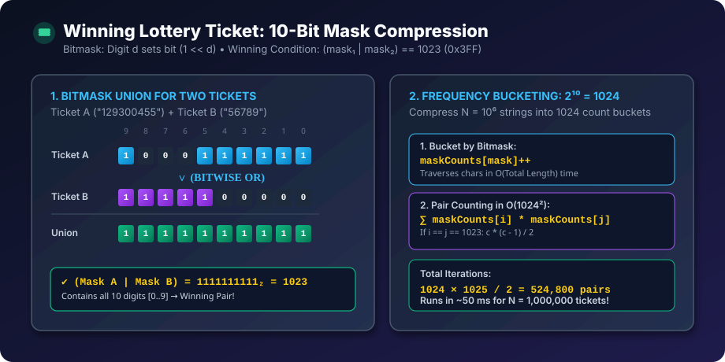
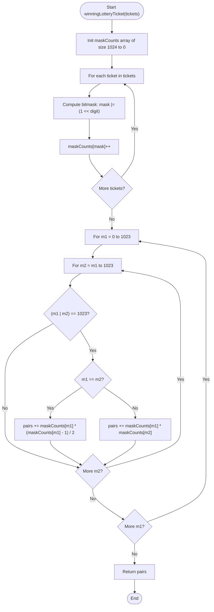

# Winning Lottery Ticket

## Problem Overview

The SuperBowl Lottery is about to commence. There are $n$ lottery tickets, where each ticket is identified by a numeric ticket ID string.
A winning pair of distinct tickets is defined as:
- The concatenation of the two ticket IDs in the pair (in any order) contains **each digit from $0$ to $9$ at least once**.

Given an array of $n$ ticket IDs, find the total number of winning pairs of distinct tickets.

Constraints:
- $1 \le n \le 10^6$
- $1 \le \text{length of ticket}_i \le 10^6$
- $\sum \text{length of ticket}_i \le 10^6$

---

## Visual Intuition: 10-Bit Bitmask Compression

Comparing all pairs of tickets directly would require $\mathcal{O}(n^2)$ comparisons. With $n = 10^6$, $\approx 5 \times 10^{11}$ operations would heavily time out.

However, we notice:
1. For each ticket, the order of characters and duplicate digits do not matter—only **which digits from $0$ to $9$ are present**.
2. We can compress every ticket into a **10-bit integer mask** ($0 \le \text{mask} \le 1023$):
   $$\text{mask} = \sum_{d \in \text{digits in ticket}} (1 \ll d)$$
3. Two tickets with masks $m_1$ and $m_2$ form a winning pair if and only if:
   $$(m_1 \mid m_2) = (1 \ll 10) - 1 = 1023 = (1111111111)_2$$
4. Since there are only $2^{10} = 1024$ possible distinct bitmasks, we can precompute the frequency of each bitmask into an array `maskCounts` of size 1024.
5. We then check all pairs of masks $(m_1, m_2)$ with $0 \le m_1 \le m_2 < 1024$ in $\approx 524,800$ iterations!

---

## Pair Counting Logic

For each pair of masks $(m_1, m_2)$ where $(m_1 \mid m_2) === 1023$:
1. If $m_1 < m_2$:
   $$\text{pairs} += \text{maskCounts}[m_1] \times \text{maskCounts}[m_2]$$
2. If $m_1 == m_2$ (which can only happen if $m_1 = 1023$):
   $$\text{pairs} += \frac{\text{maskCounts}[1023] \times (\text{maskCounts}[1023] - 1)}{2}$$

---

## Flowchart

---

## Complexity Analysis

- **Time Complexity**: $\mathcal{O}(\sum \text{len}(\text{ticket}_i) + 4^D)$ where $D = 10$ bits
  - Generating masks scans all characters in all tickets: $\mathcal{O}(\sum \text{len}(\text{ticket}_i)) \le 10^6$ operations.
  - Pairwise iteration over 1024 masks: $\frac{1024 \times 1025}{2} = 524,800$ iterations.
  - Total runtime is well under $50\text{ ms}$ for $n = 10^6$.
- **Space Complexity**: $\mathcal{O}(2^D) = \mathcal{O}(1)$
  - Constant auxiliary space of size $1024$ for the frequency array.

---

## JavaScript Solution

- View the implementation: [winningLotteryTicket.js](../Javascript/winningLotteryTicket.js)
