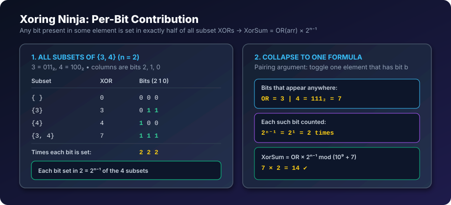
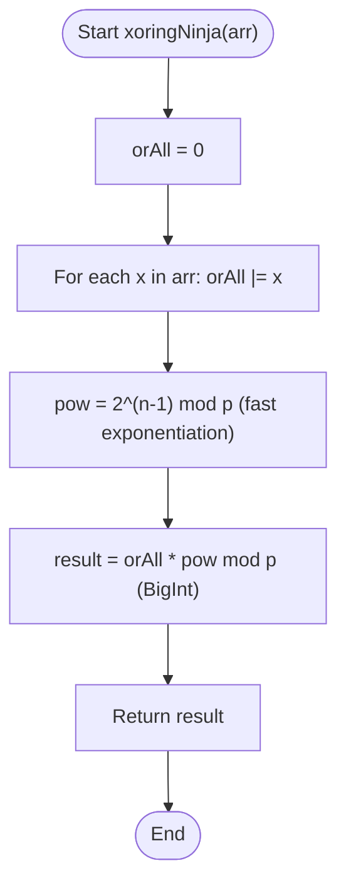

# Xoring Ninja

## Problem Overview

The $XorSum$ of a set $arr$ is the sum of the XORs of all its non-empty subsets:

$$XorSum(arr) = \sum_{i=1}^{2^n - 1} XOR(arr'_i)$$

Given an array of $n$ integers, return $XorSum(arr) \bmod (10^9 + 7)$.

Example: $arr = \{3, 4\}$ → subsets $\{3\}, \{4\}, \{3, 4\}$ → $3 + 4 + 7 = 14$.

Constraints (HackerRank):
- $1 \le T \le 5$
- $1 \le n \le 10^5$
- $0 \le arr[i] \le 10^9$

---

## Visual Intuition: Count Each Bit Separately

Enumerating $2^n - 1$ subsets is impossible for $n = 10^5$. Instead, look at **one bit position $b$ at a time**:

1. **No element has bit $b$** → no subset XOR has bit $b$ → contributes $0$.
2. **At least one element $x$ has bit $b$** → pair every subset $S$ with $S \triangle \{x\}$ (add/remove $x$). The two always differ in bit $b$, so **exactly half** of all $2^n$ subsets have bit $b$ set in their XOR: $2^{n-1}$ subsets.

So each bit that appears anywhere in the array contributes $2^b \cdot 2^{n-1}$. The bits that appear anywhere are exactly the bits of the OR of the array:

$$\boxed{XorSum(arr) = (arr_0 \mid arr_1 \mid \dots \mid arr_{n-1}) \cdot 2^{n-1}}$$

Check: $\{3, 4\}$ → $(3 \mid 4) \cdot 2^{1} = 7 \cdot 2 = 14$ ✔

---

## Precision Note

$OR < 2^{30}$ and $2^{n-1} \bmod p < 2^{30}$, so their product can reach $\approx 2^{60}$, beyond JavaScript's safe integer range ($2^{53}$). The modular multiplications use `BigInt`.

---

## Flowchart

---

## Complexity Analysis

- **Time Complexity**: $\mathcal{O}(n + \log n)$
  - One pass to compute the OR, plus $\mathcal{O}(\log n)$ fast exponentiation.
- **Space Complexity**: $\mathcal{O}(1)$

---

## JavaScript Solution

- View the implementation: [xoringNinja.js](../Javascript/xoringNinja.js)
