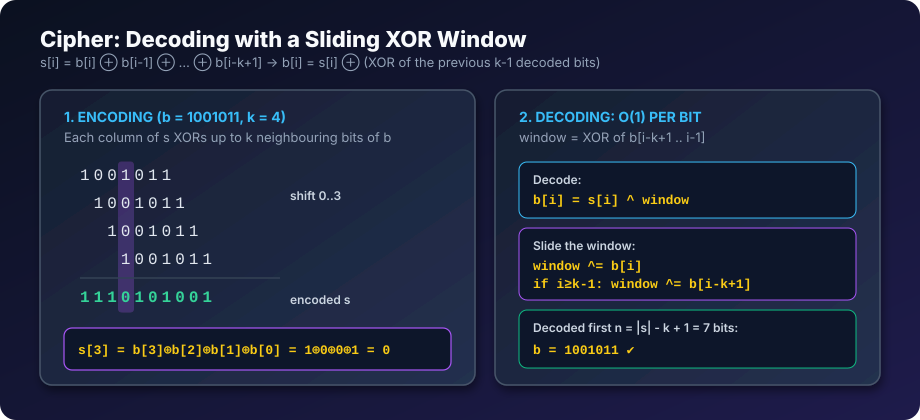
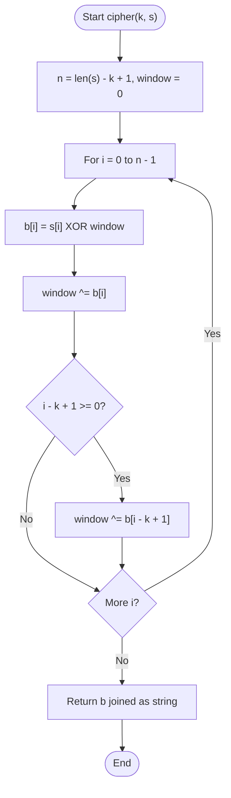

# Cipher

## Problem Overview

A binary message $b$ of length $n$ is written $k$ times, shifted right by $0, 1, \dots, k-1$ bits. XORing each column gives the encoded string $s$ of length $n + k - 1$:

```
1001011       shift 0
 1001011      shift 1
  1001011     shift 2
   1001011    shift 3
----------
1110101001    <- encoded s
```

Given $k$ and $s$, recover $b$.

Constraints (HackerRank):
- $1 \le n \le 10^6$
- $1 \le k \le 10^6$
- $|s| = n + k - 1$

---

## Visual Intuition: A Sliding XOR Window

Column $i$ holds the bits $b[i], b[i-1], \dots, b[i-k+1]$ (only the indices $\ge 0$), so:

$$s[i] = b[i] \oplus b[i-1] \oplus \dots \oplus b[i-k+1]$$

XOR both sides with the previous $k-1$ decoded bits:

$$\boxed{b[i] = s[i] \oplus \underbrace{(b[i-1] \oplus \dots \oplus b[i-k+1])}_{\text{window}}}$$

Recomputing the window every time costs $\mathcal{O}(k)$ per bit. Instead, keep it as a running XOR:
1. After decoding $b[i]$, XOR it **into** the window.
2. Once the window covers $k$ bits, XOR $b[i-k+1]$ **out**. XOR undoes itself, so this removes it.



---

## Walkthrough ($k = 4$, $s = 1110101001$)

| $i$ | $s[i]$ | window before | $b[i] = s[i] \oplus$ window | bit dropped |
|:-:|:-:|:-:|:-:|:-:|
| 0 | 1 | 0 | **1** | — |
| 1 | 1 | 1 | **0** | — |
| 2 | 1 | 1 | **0** | — |
| 3 | 0 | 1 | **1** | $b[0] = 1$ |
| 4 | 1 | 0 | **0** | $b[1] = 0$ |
| 5 | 0 | 1 | **1** | $b[2] = 0$ |
| 6 | 1 | 0 | **1** | $b[3] = 1$ |

Decoded: $b = 1001011$ ✔. Only the first $n = |s| - k + 1 = 7$ positions are decoded.

---

## Flowchart



---

## Complexity Analysis

- **Time Complexity**: $\mathcal{O}(n)$
  - Constant work per decoded bit, independent of $k$.
- **Space Complexity**: $\mathcal{O}(n)$
  - Only for the output; the window is a single integer.

---

## JavaScript Solution

- View the implementation: [cipher.js](../Javascript/cipher.js)
